<!--
  Bento profile — every tile is an animated SVG in /assets.
  Static tiles + live stats are rebuilt daily by .github/workflows/tiles.yml (scripts/build.mjs).
  Keep each row on ONE line with no spaces between tags: the gutters are baked into the SVGs.
-->

<a href="https://flowcode.fr"></a> 
<a href="https://en.wikipedia.org/wiki/First-person_view_(radio_control)"></a> 
<a href="https://github.com/Tchoow?tab=repositories"></a><a href="https://github.com/Tchoow?tab=repositories"></a><a href="https://github.com/Tchoow"></a> 
<a href="https://github.com/Tchoow"></a> 
<a href="https://flowcode.fr"></a> 
<a href="https://www.codingame.com/profile/e1b7cf093b3c8649780dc1862a1243729489804"></a><a href="https://cssbattle.dev/player/tchoow"></a><a href="https://codepen.io/collection/kNWKNk?grid_type=grid"></a><a href="https://www.root-me.org/Tcoow"></a><a href="https://app.daily.dev/tchoow"></a> 

